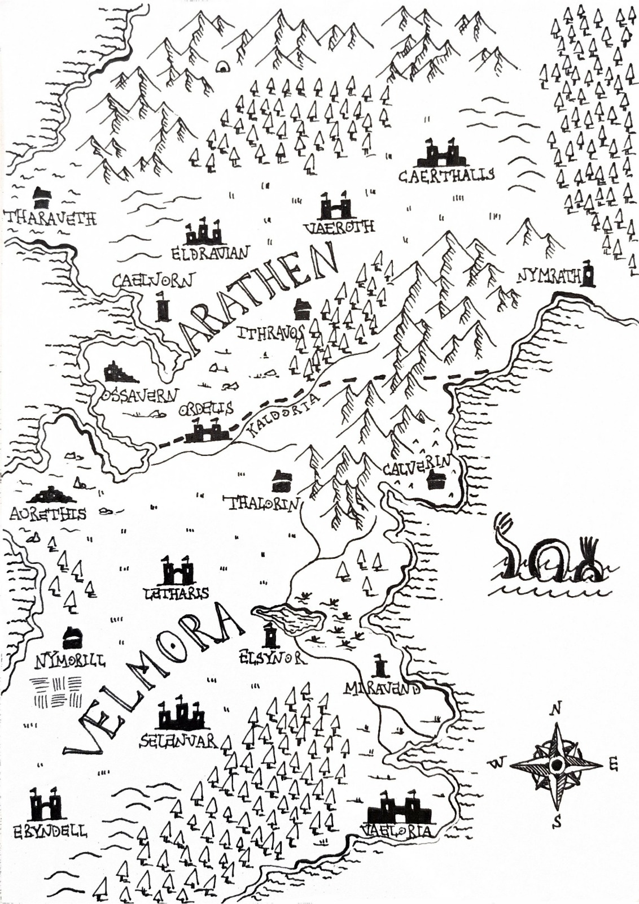

# The Veil Between Dreams

> Due regni, **Arathen** a nord e **Velmora** a sud, divisi dal fiume Kaldoria. Dopo 30 anni di guerra c'è una pace fragile, firmata 16 anni fa con il Trattato di Ordelis. Ognuno di noi ha un suo motivo per andare a Ordelis. → [Descrizione completa del mondo](./mondo.md#descrizione-iniziale-del-mondo)

## Il gruppo
Michele Foresta (Lorenzo) · Lanciolo (Marco) · Pantheon (Giacomo) · Piero (Massimo) · con noi il procione [Jimothy](./personaggi.md#jimothy) → [dettagli](./personaggi.md#il-gruppo)

## Indice
- [Diario delle sessioni](./sessioni.md)
- [Personaggi](./personaggi.md)
- [Luoghi](./luoghi.md)
- [Indizi e oggetti trovati](./indizi.md)
- [Mondo e lore](./mondo.md)

## Prossimi passi
- [x] Parlare con [Tavrin](./personaggi.md#tavrin-stonebell) dei nomi scomparsi nel registro → conosceva [Gorvin Swiftwinds](./personaggi.md#gorvin-swiftwinds)
- [x] Andare al [magazzino sud-est di Ordelis](./luoghi.md#magazzino-sud-est) → armi con documenti falsificati da Velmora, e [Jimothy](./personaggi.md#jimothy)
- [x] Capire cosa vuole [Jimothy](./personaggi.md#jimothy): i 5 oggetti e il rituale tra un giorno → recuperati i 5 oggetti, rituale fatto con gli gnomi
- [x] Affrontare il [mostro uscito dal portale](./personaggi.md#mostro-del-portale) all'[accampamento degli gnomi](./luoghi.md#accampamento-degli-gnomi) → sconfitto, ma gli gnomi sono morti; Jimothy ora viaggia con noi
- [x] Andare alla [torre a sud-ovest di Ithravos](./luoghi.md#torre-a-sud-ovest-di-ithravos) → banditi, e una [sacca](./indizi.md#sacca-della-torre) che forse è quella di Derrin (aperta da Marco)
- [ ] Ritrovare [Derrin Vale](./personaggi.md#derrin-vale) per [Khaelan](./personaggi.md#khaelan): seguire i segni di trascinamento nella torre
- [ ] Decidere cosa fare con la [sacca](./indizi.md#sacca-della-torre) ormai aperta: consegnarla a Khaelan?
- [ ] Indagare sui nomi del [taccuino](./indizi.md#taccuino) (Mireth Sylvane, Jorren Vaskel, Toren Malvek, Alaric Fenris) e sul legame con il [principe Edrin](./mondo.md#il-sonno-del-principe-edrin)
- [ ] Parlare con [Tharvian Othryndor](./personaggi.md#tharvian-othryndor) del sigillo, a Ordelis o a Vaeroth
- [x] Piero (Massimo) deve ancora riprendere i sensi

## Riassunto finora
| Sessione | Data | Cosa è successo |
|---|---|---|
| [1](./sessioni.md#sessione-1--11102026) | 11/10/2026 | Imboscata dei banditi, salviamo Tavrin, seguiamo la mappa fino alla grotta |
| [2](./sessioni.md#sessione-2--17102026) | 17/10/2026 | Ripuliamo la grotta, troviamo Massimo, sconfiggiamo la capobanda, saliamo di livello e troviamo i documenti col sigillo dell'incudine |
| [3](./sessioni.md#sessione-3--24102026) | 24/10/2026 | Massimo si sveglia, arriviamo a Ordelis e Tavrin ci parla di Gorvin Swiftwinds e dei velmoriani rapiti, Khaelan ci chiede di ritrovare Derrin Vale. Al magazzino sud-est troviamo armi con documenti falsificati da Velmora e il procione Jimothy |
| [4](./sessioni.md#sessione-4--02112026) | 02/11/2026 | Recuperiamo per Jimothy i 5 oggetti del rituale in giro per Ordelis. Nella foresta 13 gnomi celebrano il rituale e dal calderone si apre un portale da cui esce un mostro. Lo sconfiggiamo, gli gnomi muoiono e Jimothy si unisce a noi |
| [5](./sessioni.md#sessione-5--07112026) | 07/11/2026 | Alla torre a sud-ovest di Ithravos sconfiggiamo i banditi e recuperiamo dal fuoco una sacca, forse quella di Derrin Vale: una scheggia color madreperla, il ricalco di un occhio chiuso, una profezia sul velo e sul dormiente, e un taccuino che nomina Edrin |
