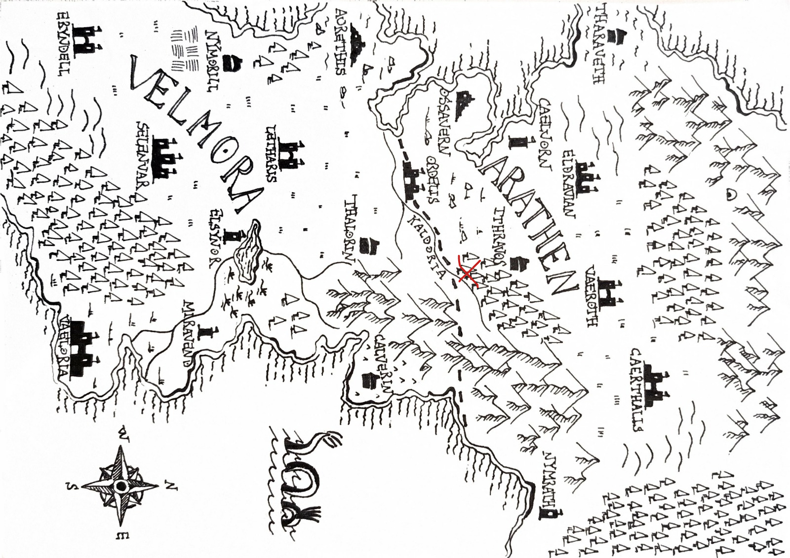

# campagna

## inizio

### Sunday 11/10/2026 23:19  

Ciascuno di noi (tranne massimo perché è un viandante che viene dall'estero) si sta recando a Ordelis che è la città di mezzo tra i due regni.

La nostra strada viene bloccata da dei banditi.
combattiamo.

### Monday 12/10/2026 00:16  

Riusciamo con non poca fatica a sconfiggere i banditi, un mercante esce fuori spaventato da sotto il carro.
Il mercante si chiama Taverin, ci invita in una taverna che si chiama golden rose, proprio in direzione di Ordelis

Giacomo trova in un cadavere un bigliettino contenente una mappa di arathen con una x rossa segnata sopra

### Monday 12/10/2026 00:42  

Decidiamo di muoverci verso la x rossa nella mappa.
Arriviamo di fronte ad una grotta, dove troviamo quello che sembra una specie di accampamento con un fuoco da campo ormai spento da un po'.

Marco lancia un cadavere infuocato da me all'interno della grotta per vedere meglio cosa c'è più avanti.
Si nota un tunnel per ancora un bel po' di metri più avanti, inoltre il tunnel non è dritto ma inizia a curvare.

### Saturday 17/10/2026 22:15  

Ci addentriamo nella caverna ed escono dei cani che ci attaccano
Dopo averli battutti (uno di questi scappa prima della fine del fight) continuiamo per quello che sembra essere l'accampamento dei banditi.

troviamo 3 gabbie, in una di queste troviamo un elfo con le braghe calate e l'ano prolassato privo di sensi.

Le altre gabbie erano vuote.

Indagando di più sul corpo di massimo si notano diversi segni di abuso, diversi segni di corda alle estremità di tutti gli arti e anche dei segni di strangolamento non troppo violento.
Un liquido gelatinoso cola dai suoi orifizi, dal retto esce fuori acqua e plasma come la ferita sul costato di Gesù Cristo.
Inoltre sono evidenti anche delle tracce di feci, non è possibile definire con certezza se le feci fossero le sue o quelle di altre persone/bestie
Non riprenderà i sensi ancora per un po', lo lasciamo riposare.

Giacomo tenta di percepire la temperatura corporea di massimo ma non avendo veri e propri termometri si accontenta di usare il suo dito, inserendolo nell'ano del povero elfo

Continuando ad andare avanti e troviamo una stanza molto grande con dei banditi dentro.
Il capo dei banditi (una donna perché è il 2026 e le donne possono ricoprire qualsiasi ruolo di potere che ricoprono gli uomini), notiamo nela stanza un enorme strap-on fatto di legno non lavorato, con ancora della corteccia e rametti attaccati.
Curiosamente era pulito.

Ci attaccano.

### Saturday 17/10/2026 23:25  

Riusciamo a battere tutti i banditi e saliamo di livello.
Marco palpa il capo dei banditi e trova una sacca di cuoio con un lucchetto.

Al suo interno trova un regiostro con scritto dentro (con una grafia di arathen) una lista di 17 persone ordinata da dei nomi, delle città, nota di carico, una rotta e uno stato.

Scorrendo la lista si nota un nome familiare, Taverin
come carico tessuti e gioielli, città nimoril, rotta da nimoril a ordelis.
come stato (passaggio terza luna)

Nella lista ci sono anche 5 nomi contrassegnati come scomparsi
Altri due con invece scritto "visto"

Alla fine del registro c'è un timbro con un simbolo di un'incudine e una spada spezzata.

Nella sacchetta troviamo anche una lettera di un corriere senza un destinatario, contiene una sola riga

    il patrono dice che non abbiamo finito finche il fiume non scorrerà rosso.

c'è anche un'istruzione di consegna per il carico in un magazzino nella riva occidentale di ordelis.

Nella lettera c'è lo stesso sigillo/timbro

Nella sacca troviamo ancora un ultimo foglietto con alcuni numeri, guardando meglio sembrano essere un registro di pagamenti perché ci sono i simboli della valuta vicino.
Le cifre sembrano essere particolarmente alta per dei lavori di brigantinaggio.
La grafia è la stessa di chi ha scritto il registro.

Guardando meglio il registro vediamo che tutte le città di provenienza sono nella regione di velmora.

### Sunday 18/10/2026 00:26  

L'idea è di andare verso Taverin per chiedergli qualcosa riguardo la lista di nomi, nello specifico se riconosce qualcuno degli scomparsi.
Successivamente potremmo andare al magazzino
