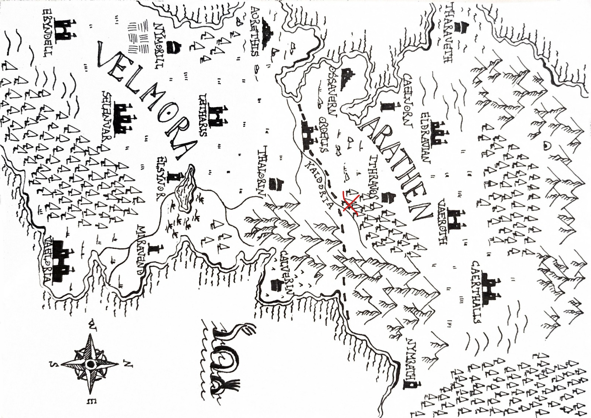
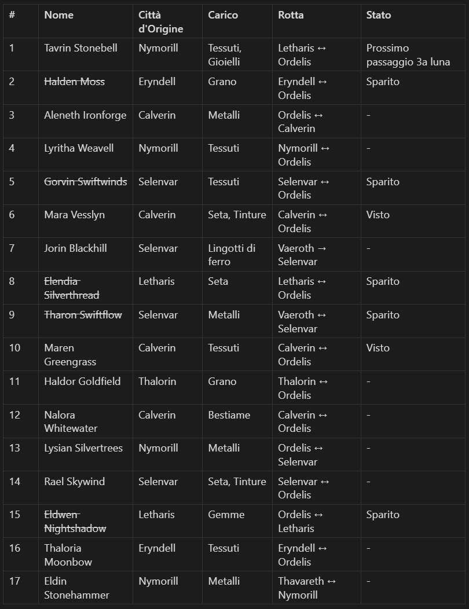
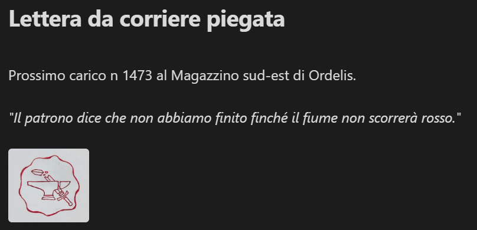
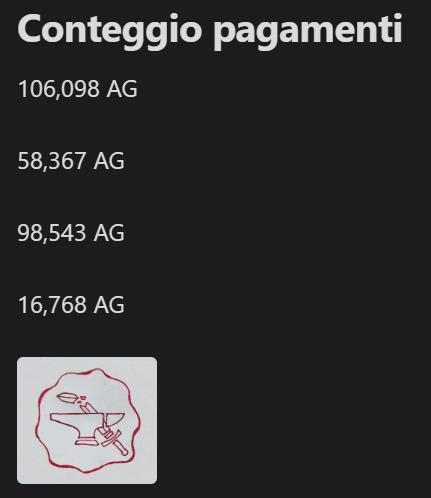

# Indizi e oggetti trovati

[← Torna alla campagna](./README.md)

## Mappa con la X rossa
Trovata da Giacomo su un cadavere dei banditi (sessione 1). Mappa di Arathen con una X rossa che indica la [grotta dei banditi](./luoghi.md#grotta-dei-banditi).

## Sacca di cuoio della capobanda
Chiusa con un lucchetto, trovata da Marco sul [capo dei banditi](./personaggi.md#capo-dei-banditi) (sessione 2). Conteneva:

### Registro dei carichi
- Scritto con una grafia di Arathen.
- Lista di 17 persone con: nome, città, nota di carico, rotta, stato.
- Tutte le città di provenienza sono nel regno di [Velmora](./luoghi.md#velmora).
- 5 nomi segnati come **scomparsi**, 2 segnati come **"visto"**.
- C'è anche [Tavrin Stonebell](./personaggi.md#tavrin-stonebell): tessuti e gioielli, da Nymorill, rotta Letharis ↔ Ordelis, stato "Prossimo passaggio 3a luna", cioè il giorno in cui lo abbiamo trovato assalito dai banditi (sessione 1).
- **Spariti** (nomi barrati): Halden Moss, Gorvin Swiftwinds, Elendia Silverthread, Tharon Swiftflow, Eldwen Nightshadow.
- **Visti:** Mara Vesslyn, Maren Greengrass (entrambi da Calverin, tessuti, rotta Calverin ↔ Ordelis).
- Quasi tutte le rotte passano da Ordelis; le eccezioni sono Jorin Blackhill e Tharon Swiftflow (Vaeroth → / ↔ Selenvar) ed Eldin Stonehammer (Thavareth ↔ Nymorill).
- Tavrin conosceva [Gorvin Swiftwinds](./personaggi.md#gorvin-swiftwinds), uno degli scomparsi (sessione 3).
- In fondo il timbro con l'[incudine e la spada spezzata](#sigillo-incudine-e-spada-spezzata).

### Lettera del corriere
Lettera piegata, senza destinatario, con lo stesso sigillo:

> Prossimo carico n 1473 al Magazzino sud-est di Ordelis.
>
> *"Il patrono dice che non abbiamo finito finché il fiume non scorrerà rosso."*

Il carico va consegnato in un [magazzino sud-est di Ordelis](./luoghi.md#magazzino-sud-est).

### Registro dei pagamenti
Foglietto intitolato "Conteggio pagamenti", con cifre troppo alte per semplici lavori di brigantaggio. Stessa grafia del registro dei carichi, con il sigillo in fondo:
- 106.098 AG
- 58.367 AG
- 98.543 AG
- 16.768 AG

Totale: 279.776 AG.

Le cifre sono troppo grandi per venire solo dai carichi delle persone scomparse (sessione 3).

## Documenti del magazzino
Trovati sulle scrivanie del [magazzino sud-est](./luoghi.md#magazzino-sud-est) nella sessione 3:
- Documenti di spedizioni con il [sigillo dell'incudine e spada spezzata](#sigillo-incudine-e-spada-spezzata), lo stesso dei documenti dei banditi.
- Documenti falsificati per carichi di armi diretti al magazzino: la falsificazione li fa apparire come provenienti da [Velmora](./luoghi.md#velmora).
- Nelle casse del magazzino: armi normali, armi con il sigillo e armi con i documenti falsificati.

## Sigillo: incudine e spada spezzata
Compare sul registro dei carichi, sulla lettera del corriere, sul registro dei pagamenti e sui [documenti del magazzino](#documenti-del-magazzino). Probabilmente il simbolo del [patrono](./personaggi.md#il-patrono) o della sua organizzazione.
Secondo [Khaelan](./personaggi.md#khaelan), [Tharvian Othryndor](./personaggi.md#tharvian-othryndor) potrebbe dirci qualcosa di più (sessione 3).

## Sacca della torre
Al secondo piano della [torre a sud-ovest di Ithravos](./luoghi.md#torre-a-sud-ovest-di-ithravos), l'ultimo bandito l'ha lanciata in un fuocherello prima di morire; Marco l'ha recuperata un po' bruciacchiata e l'ha aperta subito (sessione 5). Crediamo che sia la sacca sigillata di [Derrin Vale](./personaggi.md#derrin-vale), quella che non andava aperta. Conteneva:

### Scheggia color madreperla
Avvolta in un pezzo di stoffa. Una scheggia di qualcosa a metà tra pietra e vetro, color madreperla, piuttosto pesante per quanto è piccola.

### Ricalco di un occhio chiuso
Il foglio più sottile: il ricalco a carboncino di un occhio chiuso. Anche a pagina 37 del [taccuino](#taccuino) c'è lo schizzo di un occhio.

### Pagina strappata
Il foglio più spesso, strappato da qualche altro posto:

> *Sogna e sarai purificato*\
> *il mondo è una ferita; il velo ne è la cura*\
> *quando il sangue incoronato dormirà sotto la montagna,*\
> *l'ultima porta si aprirà*\
> *Il dormiente risorgerà*\
> *Beati coloro che non si svegliano*

### Taccuino
Rovinato e strappato in più punti, quindi non tutto si legge bene. La pagina 21 è divisa a metà tra le prime due sezioni.

#### Pagine dalla 1 alla 21

Sono presenti diverse ricerche su condizioni mediche conosciute, incrociando testi di medicina e libri botanici. Diverse pagine sono dedicate a studi di erbe medicinali e formule per rimedi curativi. È presente anche una lista di somministrazioni fatte ad un paziente, con dettagli di giorno, ora, medicina e effetto.

#### Pagine dalla 21 alla 32

La ricerca si sposta dalla semplice medicina alla magia. All'interno di queste pagine è presente una lunga lista di incantesimi e rituali magici che possano causare e curare le condizioni del paziente. Analogamente alla sezione precedente, anche qui è presente un registro di somministrazioni magiche.

Da qui le note diventano meno strutturate e più frettolose. Alcune pagine sono completamente illeggibili, forse fatto di proposito dall'autore.

#### Pagina 35

In questa pagina è presente una lista di nomi.

| Nome           | Occupazione | Indizio                                           | Stato                |
| -------------- | ----------- | ------------------------------------------------- | -------------------- |
| [Mireth Sylvane](./personaggi.md#mireth-sylvane) | Domestica   | Ha visto uomo incappucciato                       | ~~Scomparsa~~ Morta? |
| [Jorren Vaskel](./personaggi.md#jorren-vaskel)  | Maggiordomo | Voluto a corte da persone vicino al Re            | Sospetto             |
| [Toren Malvek](./personaggi.md#toren-malvek)   | Lampadaio   | Vende più olio di quanto la strada possa bruciare | -                    |
| [Alaric Fenris](./personaggi.md#alaric-fenris)  | Studioso    | Conosce il simbolo ma non vuole parlarne          | Sospetto?            |

#### Pagina 37

In questa pagina è presente uno schizzo di un occhio.
È anche presente la seguente dicitura:

*Il luogo del trattato di pace non era casuale.*

*Legame di sangue.*

*Sogno.*

#### Pagina 39

È presente la descrizione di un rituale, parzialmente bruciato.

*Stringere patto co...*

*Recarsi al temp...*

*Versare san...*

*Dorm...*

#### Pagina 40

Per metà bruciata.

*Data (2 settimane prima)*

*L'[uomo incappucciato](./personaggi.md#uomo-incappucciato) è S...*

*Edrin è nel...*

*Se funzionerà lo raggiung...*

## Domande aperte

### Il patrono e il sigillo
- Chi è il [patrono](./personaggi.md#il-patrono) della lettera del corriere? Cosa rappresenta il sigillo dell'incudine e spada spezzata? → [Tharvian Othryndor](./personaggi.md#tharvian-othryndor) potrebbe saperne di più.
- ~~Chi è il patrono di Khaelan?~~ → [Tharvian Othryndor](./personaggi.md#tharvian-othryndor). È anche il patrono della lettera del corriere, o sono due persone diverse?
- Cosa significa "finché il fiume non scorrerà rosso"? Il fiume è il [Kaldoria](./luoghi.md#fiume-kaldoria), il confine tra i due regni? Il patrono vuole far ricominciare la guerra?
- L'incudine (metalli, forgia) fa pensare ad Arathen, la spada spezzata alla guerra finita o al trattato. È un simbolo di chi è contrario alla pace?
- Perché proprio carichi e persone da Velmora? Il registro è scritto con una grafia di Arathen: c'è qualcuno di Arathen dietro?

### Il registro e gli scomparsi
- ~~Cosa vuol dire lo stato "passaggio terza luna"?~~ → Indica un giorno preciso: quello in cui abbiamo trovato [Tavrin](./personaggi.md#tavrin-stonebell) assalito dai banditi. L'imboscata era quindi pianificata per lui? Cosa volevano da lui?
- Cosa vuol dire lo stato "visto" di Mara Vesslyn e Maren Greengrass? Sono i prossimi bersagli?
- Che fine hanno fatto i 5 scomparsi, tra cui [Gorvin Swiftwinds](./personaggi.md#gorvin-swiftwinds)? C'entrano le gabbie della grotta? Tavrin dice che da un po' i velmoriani vengono rapiti durante le tratte: chi li rapisce, e perché?
- Massimo era in una delle gabbie: ora che si è svegliato, ricorda come ci è finito o ha visto altri prigionieri?

### Soldi e carichi
- Cos'è il carico n 1473? Quando arriva al [magazzino sud-est](./luoghi.md#magazzino-sud-est)? Era tra le casse di armi che abbiamo trovato?
- Perché far sembrare che le armi arrivino da Velmora? Qualcuno vuole incolpare Velmora per far ricominciare la guerra?
- Chi era l'uomo [fuggito dal magazzino](./personaggi.md#capo-del-magazzino), e da chi è andato?
- AG sono monete d'argento? Chi paga così tanto i banditi, e a chi sono andati quei pagamenti? Se non vengono solo dai carichi degli scomparsi, da dove arrivano tutti quei soldi?

### Jimothy
- Cos'è [Jimothy](./personaggi.md#jimothy), e perché era chiuso in una cassa nel magazzino?
- ~~Qual è la sua setta?~~ → Gli [gnomi](./personaggi.md#gnomi-della-setta) dell'accampamento, ora morti. ~~Quali sono i 5 oggetti?~~ → candela, cucchiaio, calzino, moneta e specchio, usati nel rituale.
- ~~Gli gnomi diventati blu e il [mostro del portale](./personaggi.md#mostro-del-portale) erano l'effetto voluto, o qualcosa è andato storto?~~ → Jimothy ha probabilmente sbagliato la ricetta della nonna. Ma cosa doveva fare il rituale, se fatto bene?
- Chi era la nonna di Jimothy, e cos'altro c'è nel suo diario?
- Chi ha catturato Jimothy e lo ha chiuso nella cassa del magazzino? Sapevano del rituale?
- Perché gli gnomi chiamano Jimothy "il loro salvatore"?

### La sacca della torre e il taccuino
- La [sacca della torre](#sacca-della-torre) è davvero quella di [Derrin Vale](./personaggi.md#derrin-vale)? Perché era destinata a [Tharvian Othryndor](./personaggi.md#tharvian-othryndor), e cosa succederà ora che l'abbiamo aperta?
- Chi ha scritto il [taccuino](#taccuino)? Il paziente delle somministrazioni è il [principe Edrin](./mondo.md#il-sonno-del-principe-edrin)?
- Cos'è la [scheggia color madreperla](#scheggia-color-madreperla), e perché è così pesante?
- L'occhio chiuso del [ricalco](#ricalco-di-un-occhio-chiuso) e quello di pagina 37 sono "il simbolo" che Alaric Fenris conosce ma non vuole spiegare? Da dove è stato ricalcato?
- Da dove viene la [pagina strappata](#pagina-strappata)? Il "sangue incoronato" che dorme sotto la montagna è Edrin? Cos'è "l'ultima porta", e chi è "il dormiente" che risorgerà?
- "Il luogo del trattato di pace non era casuale": cosa c'è di speciale a [Ordelis](./luoghi.md#ordelis) e sulle rive del Kaldoria? Cosa c'entrano il "legame di sangue" e il "sogno"?
- Il rituale di pagina 39 (patto, tempio, sangue, "Dorm...") è quello che ha fatto addormentare Edrin, o quello che l'autore voleva fare per raggiungerlo ("Se funzionerà lo raggiung...")?
- Chi è l'uomo incappucciato "S..."? Che fine ha fatto Mireth Sylvane, che lo aveva visto?
- Chi sono Jorren Vaskel, Toren Malvek e Alaric Fenris? Perché Toren Malvek vende così tanto olio?
- C'entra il "velo" della profezia con il nome della campagna?

### Derrin Vale
- ~~Cosa c'è nella sacca sigillata di [Derrin Vale](./personaggi.md#derrin-vale)?~~ → Se è la [sacca della torre](#sacca-della-torre): una scheggia, il ricalco di un occhio, una pagina strappata e un taccuino (sessione 5).
- Dov'è Derrin? I segni di trascinamento verso le scale della torre erano i suoi? È ancora vivo?
- Chi erano i banditi della torre, e per chi lavoravano? Sono legati a quelli della [grotta](./luoghi.md#grotta-dei-banditi)? Perché l'ultimo ha preferito bruciare la sacca piuttosto che lasciarcela?
- ~~La torre a nord-est di Ordelis e quella a sud-ovest di Ithravos sono la stessa torre?~~ → No: Derrin partiva da quella a sud-ovest di Ithravos ed era diretto a quella a nord di Ordelis.
- La strada tra le due torri passa vicino alla [grotta dei banditi](./luoghi.md#grotta-dei-banditi) (a sud-ovest di Ithravos, a nord-est di Ordelis): c'entrano i banditi con la sparizione di Derrin?

### Altro
- Perché le guardie di Ordelis sembravano riconoscere Marco?
- C'è un legame con il vecchio caso irrisolto di [Michele Foresta](./michele_foresta.md#storia)? Lui ha studiato sigilli e serrature: il sigillo dell'incudine gli dice qualcosa?
- C'è un legame con il [sonno del principe Edrin](./mondo.md#il-sonno-del-principe-edrin)? → Il [taccuino](#taccuino) nomina Edrin (sessione 5): c'entrano anche il sigillo dell'incudine e i velmoriani scomparsi?
