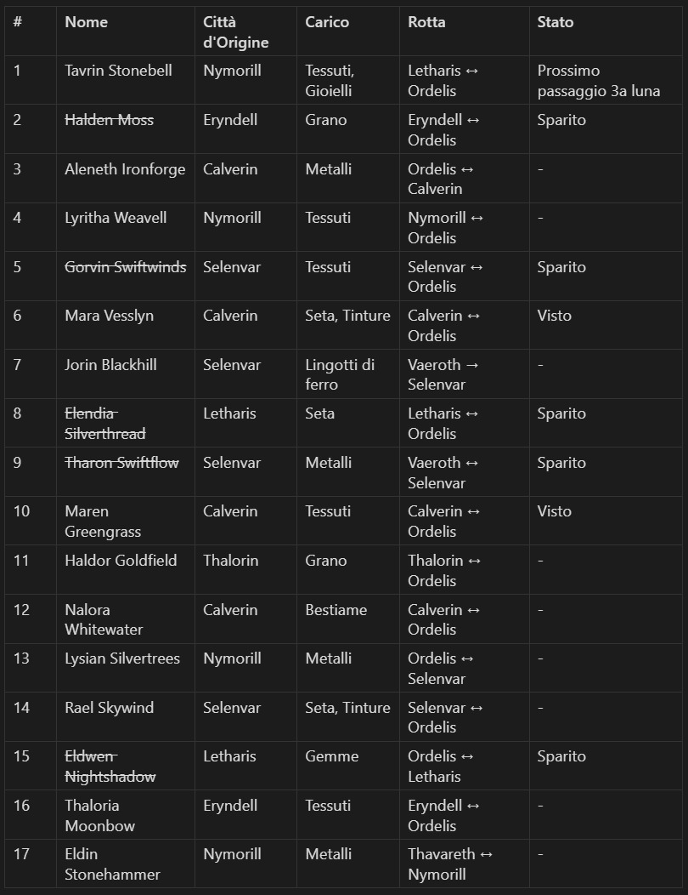
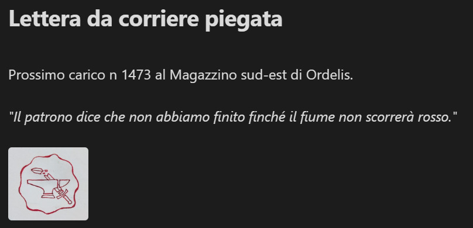
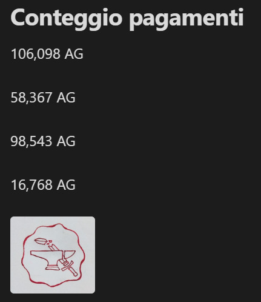

# Indizi e oggetti trovati

[← Torna alla campagna](./README.md)

## Mappa con la X rossa
Trovata da Giacomo su un cadavere dei banditi (sessione 1). Mappa di Arathen con una X rossa che indica la [grotta dei banditi](./luoghi.md#grotta-dei-banditi).

## Sacca di cuoio della capobanda
Chiusa con un lucchetto, trovata da Marco sul [capo dei banditi](./personaggi.md#capo-dei-banditi) (sessione 2). Conteneva:

### Registro dei carichi
- Scritto con una grafia di Arathen.
- Lista di 17 persone con: nome, città, nota di carico, rotta, stato.
- Tutte le città di provenienza sono nel regno di [Velmora](./luoghi.md#velmora).
- 5 nomi segnati come **scomparsi**, 2 segnati come **"visto"**.
- C'è anche [Tavrin Stonebell](./personaggi.md#tavrin-stonebell): tessuti e gioielli, da Nymorill, rotta Letharis ↔ Ordelis, stato "Prossimo passaggio 3a luna".
- **Spariti** (nomi barrati): Halden Moss, Gorvin Swiftwinds, Elendia Silverthread, Tharon Swiftflow, Eldwen Nightshadow.
- **Visti:** Mara Vesslyn, Maren Greengrass (entrambi da Calverin, tessuti, rotta Calverin ↔ Ordelis).
- Quasi tutte le rotte passano da Ordelis; le eccezioni sono Jorin Blackhill e Tharon Swiftflow (Vaeroth → / ↔ Selenvar) ed Eldin Stonehammer (Thavareth ↔ Nymorill).
- Tavrin conosceva [Gorvin Swiftwinds](./personaggi.md#gorvin-swiftwinds), uno degli scomparsi (sessione 3).
- In fondo il timbro con l'[incudine e la spada spezzata](#sigillo-incudine-e-spada-spezzata).

### Lettera del corriere
Lettera piegata, senza destinatario, con lo stesso sigillo:

> Prossimo carico n 1473 al Magazzino sud-est di Ordelis.
>
> *"Il patrono dice che non abbiamo finito finché il fiume non scorrerà rosso."*

Il carico va consegnato in un [magazzino sud-est di Ordelis](./luoghi.md#magazzino-sud-est).

### Registro dei pagamenti
Foglietto intitolato "Conteggio pagamenti", con cifre troppo alte per semplici lavori di brigantaggio. Stessa grafia del registro dei carichi, con il sigillo in fondo:
- 106.098 AG
- 58.367 AG
- 98.543 AG
- 16.768 AG

Totale: 279.776 AG.

Le cifre sono troppo grandi per venire solo dai carichi delle persone scomparse (sessione 3).

## Sigillo: incudine e spada spezzata
Compare sul registro dei carichi, sulla lettera del corriere e sul registro dei pagamenti. Probabilmente il simbolo del [patrono](./personaggi.md#il-patrono) o della sua organizzazione.
Secondo [Khaelan](./personaggi.md#khaelan), [Tharvian Othryndor](./personaggi.md#tharvian-othryndor) potrebbe dirci qualcosa di più (sessione 3).

## Domande aperte
- Chi è il patrono? Cosa rappresenta il sigillo dell'incudine e spada spezzata?
- Cosa significa "finché il fiume non scorrerà rosso"? Il fiume è il [Kaldoria](./luoghi.md#fiume-kaldoria), il confine tra i due regni? Il patrono vuole far ricominciare la guerra?
- Cosa vuol dire lo stato "passaggio terza luna"? E "visto"?
- Cos'è il carico n 1473? Quando arriva al magazzino?
- AG sono monete d'argento? A chi sono andati quei pagamenti? Se non vengono solo dai carichi degli scomparsi, da dove arrivano tutti quei soldi?
- Che fine hanno fatto i 5 scomparsi? C'entrano le gabbie della grotta? Tavrin dice che da un po' i velmoriani vengono rapiti durante le tratte: chi li rapisce, e perché?
- Perché le guardie di Ordelis sembravano riconoscere Marco?
- ~~Chi è il patrono di Khaelan?~~ → [Tharvian Othryndor](./personaggi.md#tharvian-othryndor). È anche il [patrono](./personaggi.md#il-patrono) della lettera del corriere, o sono due persone diverse?
- Cosa c'è nella sacca sigillata di Derrin Vale?
- ~~La torre a nord-est di Ordelis e quella a sud-ovest di Ithravos sono la stessa torre?~~ → No: Derrin partiva da quella a sud-ovest di Ithravos ed era diretto a quella a nord di Ordelis.
- La strada tra le due torri passa vicino alla [grotta dei banditi](./luoghi.md#grotta-dei-banditi) (a sud-ovest di Ithravos, a nord-est di Ordelis): c'entrano i banditi con la sparizione di Derrin?
- Perché proprio carichi e persone da Velmora? Il registro è scritto con una grafia di Arathen: c'è qualcuno di Arathen dietro?
- L'incudine (metalli, forgia) fa pensare ad Arathen, la spada spezzata alla guerra finita o al trattato. È un simbolo di chi è contrario alla pace?
- Chi paga così tanto i banditi?
- C'è un legame con il vecchio caso irrisolto di [Michele Foresta](./michele_foresta.md#storia)? Lui ha studiato sigilli e serrature: il sigillo dell'incudine gli dice qualcosa?
- C'è un legame con il [sonno del principe Edrin](./mondo.md#il-sonno-del-principe-edrin)?
