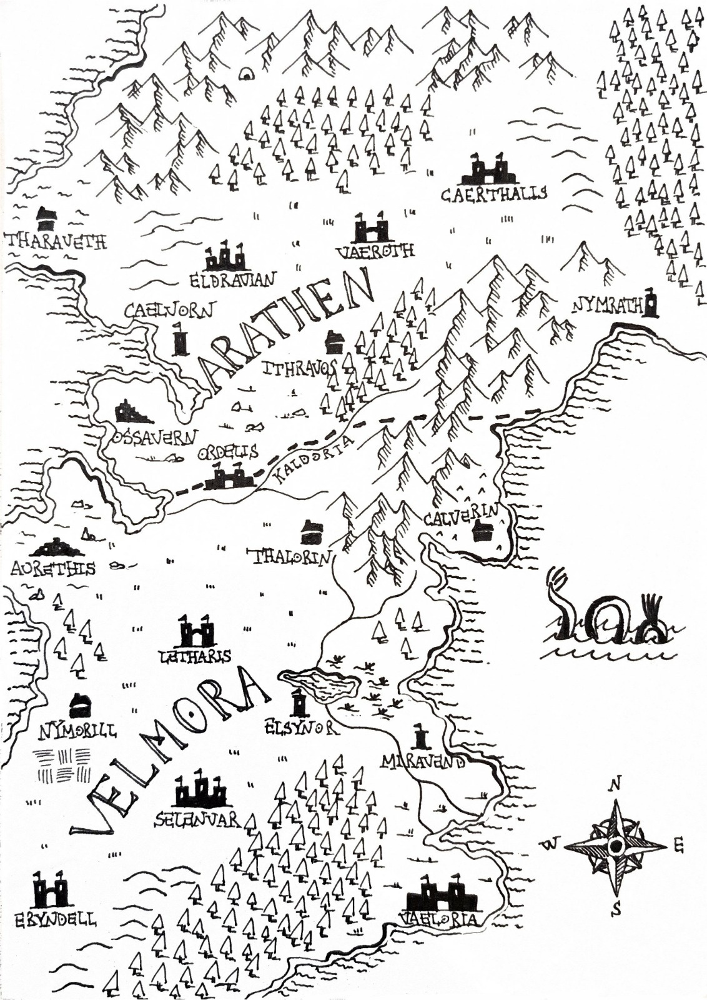

# Luoghi

[← Torna alla campagna](./README.md)

## Regni

### Arathen
Il regno a nord. È circondato da montagne a nord e a sud-est, ricco di metalli, gemme e minerali ma isolato dalle principali rotte commerciali. Re: Aldric (quello del Trattato di Ordelis, se regna ancora).
- Ha 3 casate; tra i loro leader c'è [Tharvian Othryndor](./personaggi.md#tharvian-othryndor) della casata Othrindel, cancelliere del re nanico.
- Il registro dei carichi è scritto con una grafia di Arathen.
- Vedi anche il [sonno del principe Edrin](./mondo.md#il-sonno-del-principe-edrin).

### Velmora
Il regno a sud. Pianure e terre fertili, con accesso ai mari dell'Est e dell'Ovest. Esporta raccolti, bestiame, legname e pesce, ma dipende dalle importazioni di minerali.
- Tutte le città elencate nel [registro dei carichi](./indizi.md#registro-dei-carichi) sono di Velmora.

### Fiume Kaldoria
Il fiume che divide i due regni. Il Trattato di Ordelis è stato firmato sulle sue rive.

## Città

### Ordelis
La città di mezzo tra i due regni, sulle rive del Kaldoria, la nostra destinazione iniziale. L'ha fatta costruire re Aldric di Arathen sul luogo del Trattato di Ordelis, come monumento alla pace dopo 30 anni di guerra. Ci siamo arrivati nella sessione 3: all'ingresso le guardie fanno controlli.

#### Rosa Dorata
Taverna di Ordelis. Tavrin ci aveva invitato qui e qui lo abbiamo ritrovato nella sessione 3.

#### Magazzino sud-est
Destinazione indicata nella [lettera del corriere](./indizi.md#lettera-del-corriere) trovata nella sacca della capobanda, per il prossimo carico n 1473. **Da visitare.**

### Vaeroth
Capitale dei nani. Ci potrebbe essere [Tharvian Othryndor](./personaggi.md#tharvian-othryndor). Compare anche nel [registro dei carichi](./indizi.md#registro-dei-carichi), nelle rotte di Jorin Blackhill e Tharon Swiftflow.

### Nymorill
Città di provenienza di [Tavrin](./personaggi.md#tavrin-stonebell).

## Altri luoghi

### Torre a nord di Ordelis
Torre usata spesso dai mercanti. È la destinazione di [Derrin Vale](./personaggi.md#derrin-vale), che non ci è mai arrivato (sessione 3).

### Torre a sud-ovest di Ithravos
Da qui partiva [Derrin Vale](./personaggi.md#derrin-vale) diretto alla [torre a nord di Ordelis](#torre-a-nord-di-ordelis): è l'ultimo posto dove sappiamo che è stato (sessione 3).

### Grotta dei banditi
Indicata dalla X rossa sulla [mappa trovata da Giacomo](./indizi.md#mappa-con-la-x-rossa): in Arathen, nei boschi poco a sud-ovest di Ithravos, vicino al Kaldoria e a nord-est di Ordelis. All'ingresso un accampamento con il fuoco spento; dentro un tunnel che curva, cani da guardia, 3 gabbie (in una c'era Massimo) e una grande stanza con i banditi e la loro capa. Ripulita nella sessione 2.
