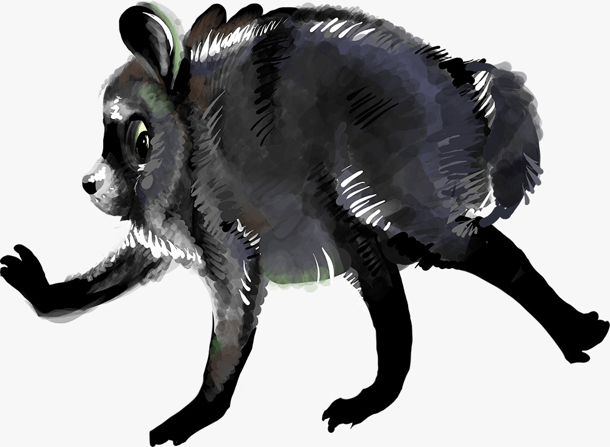

# Personaggi

[← Torna alla campagna](./README.md)

## Il gruppo

Nel [diario](./sessioni.md) i personaggi sono spesso chiamati con il nome del giocatore.

| Personaggio | Giocatore | Note |
|---|---|---|
| [Michele Foresta](./michele_foresta.md) | Lorenzo (Neepote) | Nano mago abiuratore di Cologno Monzese (Arathen), ex investigatore privato. Conosce la storia del [sonno del principe Edrin](./mondo.md#il-sonno-del-principe-edrin). Segue una pista legata a un suo vecchio caso irrisolto |
| Lanciolo | Marco (TehMark) | Nano. Barbaro, Cammino del Gigante (Path of the Giant). Abitante dei regni. Conosce la storia del [sonno del principe Edrin](./mondo.md#il-sonno-del-principe-edrin). Ha trovato la sacca di cuoio della capobanda |
| Pantheon | Giacomo (GiarickL9) | Umano, maschio. Paladino, Giuramento della Gloria (Oath of Glory, regole 2024). Ha trovato la mappa con la X rossa |
| Piero | Massimo / Dutua (maxedo99) | Elfo. Chierico, Dominio della Tempesta (Tempest Domain). Viandante venuto dall'estero. Trovato privo di sensi in una gabbia nella [grotta dei banditi](./luoghi.md#grotta-dei-banditi), si è svegliato nella sessione 3 |

## PNG incontrati

[Tavrin Stonebell](#tavrin-stonebell) (mercante halfling) · [Gorvin Swiftwinds](#gorvin-swiftwinds) (scomparso) · [Khaelan](#khaelan) (ci ha ingaggiati) · [Derrin Vale](#derrin-vale) (disperso) · [Tharvian Othryndor](#tharvian-othryndor) (cancelliere, patrono di Khaelan) · [Jimothy](#jimothy) (procione, ci ha charmati) · [Capo dei banditi](#capo-dei-banditi) (morta) · [Capo del magazzino](#capo-del-magazzino) (fuggito) · [Il patrono](#il-patrono) (sconosciuto) · [Principe Edrin](#principe-edrin) (addormentato)

### Tavrin Stonebell
Mercante halfling assalito dai banditi sulla strada per [Ordelis](./luoghi.md#ordelis); lo abbiamo salvato e ci ha invitato alla taverna [Rosa Dorata](./luoghi.md#rosa-dorata), dove lo abbiamo ritrovato nella sessione 3.
- Compare nel [registro dei carichi](./indizi.md#registro-dei-carichi): carico di tessuti e gioielli, da Nymorill, rotta Letharis ↔ Ordelis, stato "Prossimo passaggio 3a luna", cioè proprio il giorno in cui lo abbiamo salvato dai banditi.
- Conosceva [Gorvin Swiftwinds](#gorvin-swiftwinds), uno degli scomparsi. Ci ha detto che da un po' i velmoriani vengono rapiti durante le tratte commerciali (sessione 3).
- Secondo lui le cifre del [registro dei pagamenti](./indizi.md#registro-dei-pagamenti) sono troppo grandi per venire solo dai carichi degli scomparsi (sessione 3).

### Gorvin Swiftwinds
Uno dei 5 nomi segnati come scomparsi nel [registro dei carichi](./indizi.md#registro-dei-carichi). Vendeva tessuti come Tavrin, ed è così che si conoscevano (sessione 3).

### Khaelan
Umano, sembra di famiglia nobile. Ci ha fermati alla [Rosa Dorata](./luoghi.md#rosa-dorata) nella sessione 3 e ci ha ingaggiati: dobbiamo ritrovare [Derrin Vale](#derrin-vale) e la sua sacca sigillata, destinata al suo patrono, [Tharvian Othryndor](#tharvian-othryndor). Abbiamo accettato, ma prima andiamo ai magazzini.
- Il suo padrone è "molto potente": aprire il pacco porterà a conseguenze.
- Ci ha indicato il suo stesso patrono, Tharvian, per saperne di più sul [sigillo](./indizi.md#sigillo-incudine-e-spada-spezzata).

### Derrin Vale
Mercante disperso, con una sacca sigillata che contiene un carico importante per [Tharvian Othryndor](#tharvian-othryndor), il patrono di [Khaelan](#khaelan). Partito dalla [torre a sud-ovest di Ithravos](./luoghi.md#torre-a-sud-ovest-di-ithravos), non è mai arrivato alla [torre a nord di Ordelis](./luoghi.md#torre-a-nord-di-ordelis) (sessione 3).

### Tharvian Othryndor
Cancelliere del re nanico, uno dei leader delle 3 casate di [Arathen](./luoghi.md#arathen) e una delle persone più influenti del regno. Di cognome fa Othryndor, ma fa parte della casata Othrindel. È il patrono di [Khaelan](#khaelan): la sacca sigillata di [Derrin Vale](#derrin-vale) era destinata a lui. Secondo Khaelan potrebbe dirci qualcosa sul [sigillo](./indizi.md#sigillo-incudine-e-spada-spezzata) (sessione 3).
- Si potrebbe trovare alla corte reale, a [Ordelis](./luoghi.md#ordelis) o a [Vaeroth](./luoghi.md#vaeroth).

### Jimothy
Una specie di procione strano, trovato chiuso in una cassa nel [magazzino sud-est](./luoghi.md#magazzino-sud-est) di Ordelis: lo abbiamo sentito lamentarsi quando Massimo ha colpito la cassa per sbaglio (sessione 3).
- Comunica con noi nella lingua dei segni.
- Ha charmato Lorenzo e Giacomo, chiedendo se siamo suoi sudditi, membri della sua setta.
- Dice che dobbiamo sbrigarci a cercare 5 oggetti per un rituale che avverrà tra un giorno.
- Non ha risposto alle nostre domande sul carico, sul fiume e sul timbro: ci ha ignorati e intanto si specchiava su un pezzo di metallo.

### Capo dei banditi
Donna a capo dei banditi della [grotta](./luoghi.md#grotta-dei-banditi). Sconfitta nella sessione 2.
Aveva con sé la sacca di cuoio con il registro, la lettera del corriere e il registro dei pagamenti.

### Capo del magazzino
Uno degli uomini del [magazzino sud-est](./luoghi.md#magazzino-sud-est), forse un capo o comunque qualcuno di importante. È scappato durante il combattimento, mentre gli altri sono stati uccisi (sessione 3).

### Il patrono
Nominato nella [lettera del corriere](./indizi.md#lettera-del-corriere). Probabilmente il mandante dei banditi. Identità sconosciuta.

### Principe Edrin
Principe ereditario di Arathen. Vedi [Mondo e lore](./mondo.md#il-sonno-del-principe-edrin).
