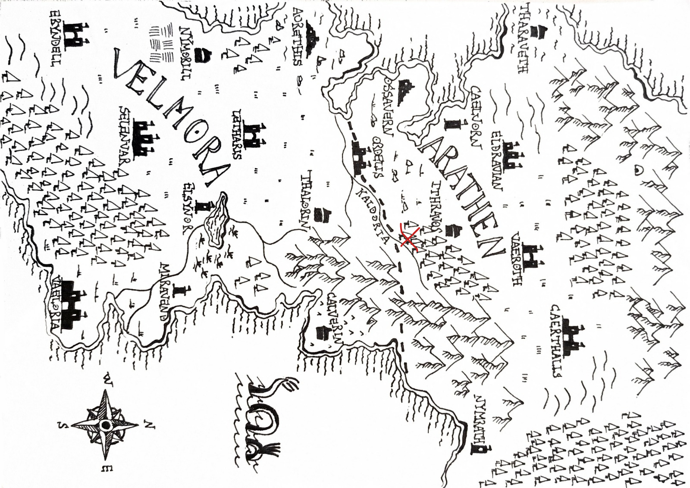
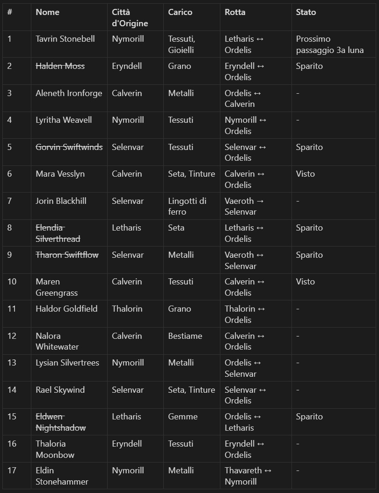
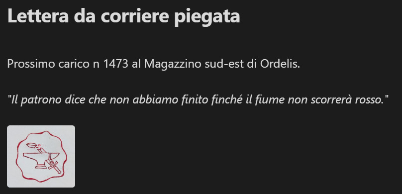
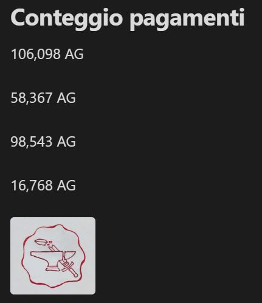
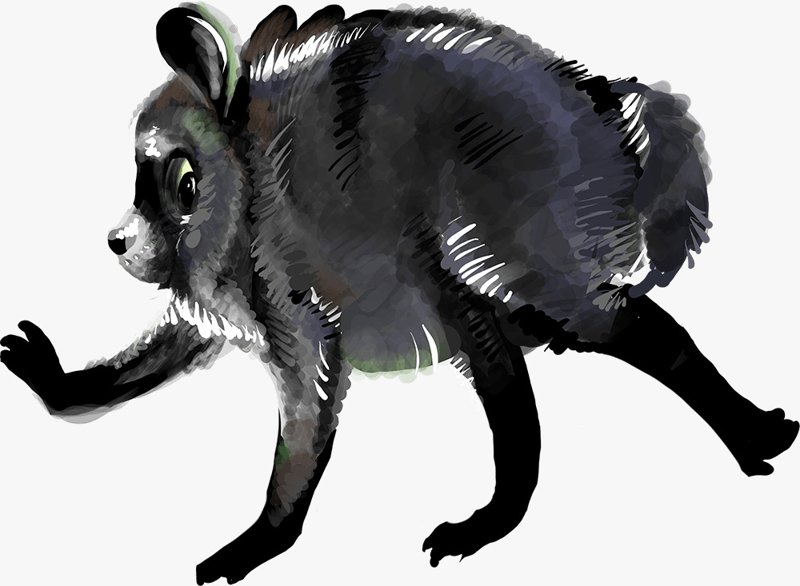

# Diario delle sessioni

[← Torna alla campagna](./README.md)

- [Sessione 1 — 11/10/2026](#sessione-1--11102026)
- [Sessione 2 — 17/10/2026](#sessione-2--17102026)
- [Sessione 3 — 24/10/2026](#sessione-3--24102026)
- [Sessione 4 — 02/11/2026](#sessione-4--02112026)
- [Sessione 5 — 07/11/2026](#sessione-5--07112026)

## Sessione 1 — 11/10/2026

> **In breve:** imboscata dei banditi sulla strada per Ordelis, salviamo il mercante Tavrin, troviamo una mappa con una X rossa e la seguiamo fino a una grotta.

### Domenica 11/10/2026 23:19

Ciascuno di noi (tranne Massimo perché è un viandante che viene dall'estero) si sta recando a [Ordelis](./luoghi.md#ordelis) che è la città di mezzo tra i due regni.

La nostra strada viene bloccata da dei banditi.
Combattiamo.

### Lunedì 12/10/2026 00:16

Riusciamo con non poca fatica a sconfiggere i banditi, un mercante esce fuori spaventato da sotto il carro.
Il mercante si chiama [Tavrin](./personaggi.md#tavrin-stonebell), ci invita in una taverna che si chiama [Rosa Dorata](./luoghi.md#rosa-dorata), proprio in direzione di Ordelis.

Giacomo trova in un cadavere un bigliettino contenente una mappa di Arathen con una x rossa segnata sopra.

### Lunedì 12/10/2026 00:42

Decidiamo di muoverci verso la x rossa nella mappa.
Arriviamo di fronte ad una [grotta](./luoghi.md#grotta-dei-banditi), dove troviamo quello che sembra una specie di accampamento con un fuoco da campo ormai spento da un po'.

Marco lancia un cadavere infuocato da me all'interno della grotta per vedere meglio cosa c'è più avanti.
Si nota un tunnel per ancora un bel po' di metri più avanti, inoltre il tunnel non è dritto ma inizia a curvare.

## Sessione 2 — 17/10/2026

> **In breve:** ripuliamo la grotta dei banditi, troviamo Massimo in una gabbia, sconfiggiamo la capobanda e saliamo di livello. Nella sua sacca: un registro di carichi e persone scomparse, una lettera del "patrono" e un registro di pagamenti, tutti con il sigillo dell'incudine e spada spezzata.

### Sabato 17/10/2026 22:15

Ci addentriamo nella caverna ed escono dei cani che ci attaccano.
Dopo averli battuti (uno di questi scappa prima della fine del combattimento) continuiamo per quello che sembra essere l'accampamento dei banditi.

Troviamo 3 gabbie, in una di queste troviamo un elfo con le braghe calate e l'ano prolassato privo di sensi.

Le altre gabbie erano vuote.

Indagando di più sul corpo di Massimo si notano diversi segni di abuso, diversi segni di corda alle estremità di tutti gli arti e anche dei segni di strangolamento non troppo violento.
Un liquido gelatinoso cola dai suoi orifizi, dal retto esce fuori acqua e plasma come la ferita sul costato di Gesù Cristo.
Inoltre sono evidenti anche delle tracce di feci, non è possibile definire con certezza se le feci fossero le sue o quelle di altre persone/bestie.
Non riprenderà i sensi ancora per un po', lo lasciamo riposare.

Giacomo tenta di percepire la temperatura corporea di Massimo ma non avendo veri e propri termometri si accontenta di usare il suo dito, inserendolo nell'ano del povero elfo.

Continuando ad andare avanti troviamo una stanza molto grande con dei banditi dentro.
Il [capo dei banditi](./personaggi.md#capo-dei-banditi) (una donna perché è il 2026 e le donne possono ricoprire qualsiasi ruolo di potere che ricoprono gli uomini), notiamo nella stanza un enorme strap-on fatto di legno non lavorato, con ancora della corteccia e rametti attaccati.
Curiosamente era pulito.

Ci attaccano.

### Sabato 17/10/2026 23:25

Riusciamo a battere tutti i banditi e **saliamo di livello**.
Marco palpa il capo dei banditi e trova una sacca di cuoio con un lucchetto.

Al suo interno trova un [registro](./indizi.md#registro-dei-carichi) con scritto dentro (con una grafia di Arathen) una lista di 17 persone ordinata da dei nomi, delle città, nota di carico, una rotta e uno stato.

Scorrendo la lista si nota un nome familiare, [Tavrin](./personaggi.md#tavrin-stonebell):
come carico tessuti e gioielli, città Nymorill, rotta da Letharis a Ordelis,
come stato (passaggio terza luna).

Nella lista ci sono anche 5 nomi contrassegnati come scomparsi.
Altri due con invece scritto "visto".

Alla fine del registro c'è un timbro con un simbolo di un'[incudine e una spada spezzata](./indizi.md#sigillo-incudine-e-spada-spezzata).

Nella sacchetta troviamo anche una [lettera di un corriere](./indizi.md#lettera-del-corriere) senza un destinatario, contiene una sola riga:

    il patrono dice che non abbiamo finito finché il fiume non scorrerà rosso.

C'è anche un'istruzione di consegna per il carico in un [magazzino sud-est di Ordelis](./luoghi.md#magazzino-sud-est).

Nella lettera c'è lo stesso sigillo/timbro.

Nella sacca troviamo ancora un ultimo foglietto con alcuni numeri, guardando meglio sembrano essere un [registro di pagamenti](./indizi.md#registro-dei-pagamenti) perché ci sono i simboli della valuta vicino.
Le cifre sembrano essere particolarmente alte per dei lavori di brigantaggio.
La grafia è la stessa di chi ha scritto il registro.

Guardando meglio il registro vediamo che tutte le città di provenienza sono nel regno di [Velmora](./luoghi.md#velmora).

### Domenica 18/10/2026 00:26

L'idea è di andare verso Tavrin per chiedergli qualcosa riguardo la lista di nomi, nello specifico se riconosce qualcuno degli scomparsi.
Successivamente potremmo andare al magazzino.

## Sessione 3 — 24/10/2026

> **In breve:** Massimo si sveglia, entriamo a Ordelis e troviamo Tavrin alla Rosa Dorata: conosceva Gorvin Swiftwinds, uno degli scomparsi, e ci dice che da un po' i velmoriani vengono rapiti durante le tratte. Il nobile Khaelan ci chiede di ritrovare il mercante Derrin Vale e ci indica Tharvian Othryndor per saperne di più sul sigillo. Al magazzino sud-est veniamo attaccati: troviamo Jimothy, uno strano procione chiuso in una cassa, e casse di armi con documenti falsificati per farle sembrare provenienti da Velmora.

### Sabato 24/10/2026 23:15

Massimo si sveglia e nel mentre che parliamo scende la notte, ci incamminiamo verso [Ordelis](./luoghi.md#ordelis).
Mentre entriamo in città veniamo fermati dalle guardie giusto per dei controlli, sembravano quasi riconoscere Marco.
Chiediamo alle guardie come arrivare alla [Rosa Dorata](./luoghi.md#rosa-dorata) e gentilmente ce lo indicano.
Giacomo appena entrati urla chiedendo di [Tavrin](./personaggi.md#tavrin-stonebell).
Vediamo l'halfling che sta bevendo la sua quinta birra, come ci vede ci offre da bere e parla di noi ai suoi amici nella taverna.

Parlando con Tavrin ci dice che conosceva una delle persone scomparse, [Gorvin Swiftwinds](./personaggi.md#gorvin-swiftwinds), e aggiunge che è da un po' che i velmoriani vengono rapiti durante le tratte commerciali.
Anche Gorvin vendeva tessuti, per questo si conoscevano.
Inoltre Tavrin ha detto che le cifre segnate sul [foglio](./indizi.md#registro-dei-pagamenti) sono troppo grandi per essere prese solo dai carichi delle persone scomparse.

Andiamo a dormire.

### Sabato 24/10/2026 23:54

Uscendo dalle stanze un tizio ci ferma.
Un umano che sembra provenire da una famiglia nobile.
Si chiama [Khaelan](./personaggi.md#khaelan). Ci vuole ingaggiare per ritrovare un mercante che ha una sacca sigillata con un carico importante per il suo patrono. Il mercante da trovare si chiama [Derrin Vale](./personaggi.md#derrin-vale).
Sarebbe dovuto arrivare ad una [torre](./luoghi.md#torre-a-nord-di-ordelis) che usano spesso i mercanti che si trova a nord di Ordelis.
L'ultimo posto dove dovrebbe essere arrivato è una [torre a sud ovest di Ithravos](./luoghi.md#torre-a-sud-ovest-di-ithravos).

Aprire il pacco porterà a conseguenze, il suo padrone è molto potente.

Accettiamo l'incarico.

Chiediamo anche del [simbolo](./indizi.md#sigillo-incudine-e-spada-spezzata) e ci dice che un certo [Tharvian Othryndor](./personaggi.md#tharvian-othryndor) potrebbe dirci qualcosa in più a riguardo, che è uno dei leader delle 3 casate di Arathen.

Pensandoci mi ricordo che Tharvian è il cancelliere del re nanico, ed è una delle persone più influenti nel regno e fa parte della famiglia Othrindel.
Probabilmente potremmo parlare con lui nella corte reale, potrebbe trovarsi sia ad [Ordelis](./luoghi.md#ordelis) che nella capitale dei nani [Vaeroth](./luoghi.md#vaeroth).

Prima di cercare Derrin decidiamo comunque di incamminarci verso i [magazzini a sud est di Ordelis](./luoghi.md#magazzino-sud-est).

Fermando un tizio per strada ci dice che c'è un magazzino poco fuori di lì che però è considerato abbandonato, ci avviciniamo lì.

Sentiamo delle voci all'interno del magazzino, perciò non è davvero abbandonato

Massimo prova a interagire con delle persone ma ci attaccano

### Domenica 25/10/2026 01:33

Nel combattimento uno dei tizi dentro scappa, probabilmente era un capo o comunque qualcuno di importante, per il resto uccidiamo tutti.

Massimo per sbaglio nel combattimento colpisce una cassa e sentiamo un lamento provenire da lì dentro.

Troviamo [Jimothy](./personaggi.md#jimothy) una specie di procione strano che riesce a comunicare con noi attraverso la lingua dei segni.
Io e Giacomo veniamo charmati da Jimothy, che ci chiede se siamo suoi sudditi, membri della sua setta. Ha detto che ci dovremmo sbrigare a cercare 5 oggetti per il rituale che avverrà tra un giorno.

Invece investigando nel capannone, troviamo delle scrivanie dove ci sono dei documenti con lo stesso [timbro](./indizi.md#sigillo-incudine-e-spada-spezzata) che avevamo trovato nei documenti dei banditi.
Troviamo dei documenti riguardanti spedizioni con il logo e altri [documenti falsificati](./indizi.md#documenti-del-magazzino) per carichi di armi verso questo magazzino, la falsificazione li fa apparire come provenienti da [Velmora](./luoghi.md#velmora).

Nelle casse ci sono armi normali e altre hanno ancora il logo trovato prima, altre invece hanno i documenti falsificati

[Jimothy](./personaggi.md#jimothy) non ci ha risposto nulla sulle domande fatte riguardo il carico, il fiume e il timbro, ci ha ignorato e nel mentre si specchiava su un pezzo di metallo

## Sessione 4 — 02/11/2026

> **In breve:** giriamo Ordelis con Jimothy per recuperare i 5 oggetti del rituale: la candela al contrario rubata a un bambino, il cucchiaio con la testa di goblin della Pustola Ululante, il calzino incrostato di un orco, una moneta di rame dal conio sconosciuto e lo specchio che mostra il passato di un'attrice in declino. Nella foresta 13 gnomi celebrano il rituale, ma dal calderone si apre un portale da cui esce un mostro. Lo sconfiggiamo, ma gli gnomi muoiono: Jimothy aveva solo sbagliato la ricetta della nonna, e ora viaggia con noi.

### Lunedì 02/11/2026 22:09

[Jimothy](./personaggi.md#jimothy) ha detto che per il rituale serve:

- un cucchiaio molto speciale (ci porterà lui)
- un calzino, molto particolare, impregnato di una sostanza magica (più o meno)
- una moneta anch'essa molto speciale
- una candela molto magica
- uno specchio portatile molto speciale

Jimothy si aggirava in questi [magazzini](./luoghi.md#magazzino-sud-est) che la candela si trovava qui vicino, ma è stato poi catturato

La "candela" è una candela al contrario che fluttua viene considerata un giocattolo da alcuni 

Decidiamo di cercare la candela, Jimothy ci porta ad [Ordelis](./luoghi.md#ordelis).
Punta verso un bambino e dice che quel bambino ha questo giocattolo.
Massimo ruba la candela al bambino e Jimothy ne rimane compiaciuto

Decidiamo di andare a prendere il cucchiaio come secondo oggetto.
Questo cucchiaio ha alla fine del manico una testa di goblin, si trova in una locanda di una zona malfamata. Il locale si chiama la [Pustola Ululante](./luoghi.md#pustola-ululante), il cucchiaio è del proprietario di questa locanda.

Marco distrae il locandiere e riusciamo a prendere il mestolo.
Decidiamo di andare a prendere il calzino come terzo

Ci dirigiamo verso una zona residenziale di Ordelis, indica il secondo piano di un'abitazione e dice che il calzino si trova lì dentro

Marco scala una grondaia per entrare nella casa dalla finestra, al suo interno vede un orco affetto da sindrome di down con un calzino incrostato appoggiato sul petto.
Marco riesce a recuperare il sacro indumento e a lanciarlo fuori dalla finestra verso di noi

Andiamo a cercare la moneta, che è di rame e ha un conio sconosciuto, la riconosceremo perché non l'abbiamo mai vista.
Jimothy ci conduce alle porte di Ordelis, indicando una barbona zoppa con un cappello usato per l'elemosina.
Marco praticamente compra la moneta dalla vecchia con una moneta d'oro

Rimane solo lo specchio
Un piccolo specchio tascabile con il manico, molto grazioso ma con una particolarità
guardando allo specchio si vede l'immagine precedente di 2,37 minuti prima.

Arriviamo nell'[ex villa dei Casamonica](./luoghi.md#ex-villa-dei-casamonica), la riconosco come la casa di una delle [nobili aratheniane](./personaggi.md#attrice-aratheniana), popolare attrice di teatro ormai in declino
Dopo averla intimidita riusciamo a prendere anche lo specchio.

Jimothy ci porta fuori da Ordelis, nella foresta. Ad un certo punto arriviamo in uno [spiazzo](./luoghi.md#accampamento-degli-gnomi) dove ci sono delle tende.
Come arriviamo nello spiazzo veniamo raggiunti da 13 [gnomi](./personaggi.md#gnomi-della-setta) che gioiosamente accolgono noi e Jimothy il loro salvatore.

Gli gnomi iniziano subito a prepararsi per il rituale, prendono un pentolone e lo poggiano sopra una specie di disegno, all'interno vengono inseriti il calzino e il mestolo.
Versano dell'acqua e usano lo specchio per convogliare la luce lunare per accendere il fuoco sotto il pentolone
Dopo sette minuti che l'intruglio ha bollito, gli gnomi iniziano a berlo.
Jimothy prende la moneta e la lancia in aria, facendola cadere a terra, prova a rilanciarla facendola cadere sopra la base della candela (perché la candela è al contrario).
Nell'istante in cui questo accade gli gnomi diventano blu e iniziano a tremare.
Inizia ad uscire un portale dimensionale da dove si trova il calderone, da cui escono fuori dei tentacoli e poi un [mostro](./personaggi.md#mostro-del-portale)

Riusciamo a sconfiggere il mostro che poi ritorna nel suo portale, gli gnomi smettono di vibrare e cascano a terra morti

Jimothy voleva solo seguire la ricetta trovata nel diario di sua nonna, probabilmente ha sbagliato qualcosa nella ricetta. Si prenderà una pausa dall'essere un capo di setta e ci seguirà per i nostri viaggi.

## Sessione 5 — 07/11/2026

> **In breve:** con Jimothy andiamo alla torre a sud-ovest di Ithravos, dove ci attaccano dei banditi su entrambi i piani. L'ultimo prova a bruciare una sacca, forse quella di Derrin Vale: dentro una scheggia color madreperla, il ricalco di un occhio chiuso, una pagina strappata con una profezia sul velo e sul dormiente, e un taccuino di ricerche su un paziente che nomina Edrin.

### Sabato 07/11/2026 22:13

Dormiamo nelle tende degli [gnomi](./luoghi.md#accampamento-degli-gnomi) per fare un long rest

Decidiamo di incamminarci verso la [torre a sud ovest di Ithravos](./luoghi.md#torre-a-sud-ovest-di-ithravos) insieme al nostro nuovo compagno [Jimothy](./personaggi.md#jimothy).
Ci ritroviamo di fronte una torre a due piani con una porta di legno chiusa, Giacomo entra e veniamo assaliti da dei banditi.
Sconfitti i banditi abbiamo esplorato la stanza al piano terra della torre, e abbiamo notato dei segni di trascinamento che andavano verso le scale
Al secondo piano veniamo assaliti da altri banditi.
Come Marco sta per sferrare l'ultimo colpo all'ultimo dei banditi, il bandito lancia una [sacca](./indizi.md#sacca-della-torre) in un fuocherello acceso nella stanza.
Non appena finito il combattimento Marco lancia Jimothy e recupera la sacca che rimane un po' bruciacchiata.

Marco apre subito la sacca (che crediamo essere quella che non andava aperta), trova un [taccuino](./indizi.md#taccuino),
2 fogli di carta, uno più rovinato dell'altro (uno sottile e uno un po' più spesso dove si nota che sia stato strappato), e un oggetto avvolto in un pezzo di stoffa.
Marco toglie la pezza e vede una [scheggia](./indizi.md#scheggia-color-madreperla) di quella che sembra essere qualcosa tra pietra e vetro.
La scheggia è in un colore come madreperla e sembra essere piuttosto pesante per quanto è grande.

Partendo dal foglio più sottile, aprendolo vedo che è un [ricalco](./indizi.md#ricalco-di-un-occhio-chiuso) fatto con un carboncino di un occhio chiuso.
Invece il foglio più spesso, è una [pagina strappata](./indizi.md#pagina-strappata) da qualche altro posto. C'è scritto

    Sogna e sarai purificato
    il mondo è una ferita; il velo ne è la cura
    quando il sangue incoronato dormirà sotto la montagna,
    l'ultima porta si aprirà
    Il dormiente risorgerà
    Beati coloro che non si svegliano

Infine il [taccuino](./indizi.md#taccuino)
